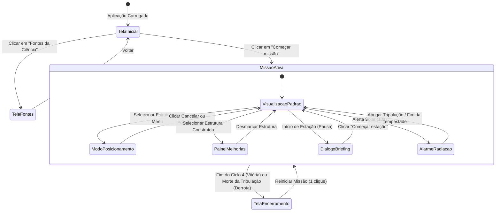

# Modelo de Dados da Interface: UI 2D do Jogo e Kit de UI

**Funcionalidade**: `specs/003-game-ui/` | **Data**: 2026-11-14 | **Branch**: `ui/003-game-ui`

Este documento especifica as entidades, modelos de visualização (view models), estruturas de dados e regras de validação consumidas e apresentadas pela UI 2D e pelo Kit de UI.

---

## 1. Entidades e Modelos de Visualização

### 1.1 Medidor de Reserva Vital (`VitalBarViewModel`)
Representa a exibição de uma reserva crítica no HUD.

- **Campos**:
  - `id`: `'oxygen' | 'water' | 'food'` (identificador do recurso)
  - `name`: `LocalizedText` (nome traduzido do recurso)
  - `current`: `number` (quantidade atual em estoque)
  - `target`: `number` (meta de vitória da colônia: 16 O₂, 32 H₂O, 16 Comida)
  - `dangerThreshold`: `number` (patamar de alerta equivalente a 1 estação para 4 pessoas: 4 O₂, 8 H₂O, 4 Comida)
  - `isLow`: `boolean` (`current < dangerThreshold`)
  - `isZero`: `boolean` (`current <= 0`)
  - `unit`: `string` (`"U"`)
- **Regras de Validação & Exibição**:
  - Se `isLow` for verdadeiro, ativa classe de animação pulsante (`pulse-warning`) e exibe ícone de alerta.
  - A barra visual preenche de 0% a 100% com base no percentual em relação à meta de vitória (`target`).
  - Um marcador fixo na barra sinaliza visualmente a posição da meta de vitória.

### 1.2 Medidor de Energia (`PowerMeterViewModel`)
Representa o balanço elétrico da base no HUD.

- **Campos**:
  - `productionKw`: `number` (geração total em kW)
  - `demandKw`: `number` (demanda total em kW)
  - `balanceKw`: `number` (superávit ou déficit: `production - demand`)
  - `batteryEu`: `number` (energia armazenada em baterias)
  - `isDeficit`: `boolean` (`balanceKw < 0`)
  - `unheated`: `boolean` (indica se nem os habitats conseguem ser aquecidos)
- **Regras de Validação & Exibição**:
  - Se `balanceKw >= 0`, exibe com prefixo `+` e cor informativa/neutra.
  - Se `isDeficit` for verdadeiro, exibe com estilo de alerta (cor de aviso + ícone negativo).
  - Se `unheated` for verdadeiro, ativa alarme crítico de frio com contagem regressiva de risco de morte.

### 1.3 Carteira de Materiais (`WalletViewModel`)
Representa os recursos de construção e manutenção no HUD.

- **Campos**:
  - `items`: Lista de itens contendo:
    - `id`: `'hematite' | 'regolith' | 'iron' | 'steel' | 'repair_parts'`
    - `name`: `LocalizedText`
    - `count`: `number` (quantidade inteira disponível)
    - `icon`: `string` (identificador do ícone correspondente)
- **Regras de Validação & Exibição**:
  - Valores são arredondados para números inteiros inferiores (`Math.floor`).
  - Nunca é exibida em formato de barra de falha, apenas como contadores compactos.

### 1.4 Painel de Tripulação (`CrewMemberViewModel`)
Representa o estado individual de cada um dos 4 astronautas.

- **Campos**:
  - `id`: `string`
  - `name`: `string` (ex.: "Dr. Scott", "Eng. Chen")
  - `alive`: `boolean`
  - `location`: `'inside' | 'outside'`
  - `exposure`: `number` (0 a 1; valor decimal da exposição à radiação)
  - `exposurePercent`: `number` (`Math.round(exposure * 100)`)
  - `isWarning`: `boolean` (`exposure >= 0.75`)
  - `currentJobKind`: `'build' | 'upgrade' | 'repair' | 'clean' | null`
- **Regras de Validação & Exibição**:
  - Se `!alive`, exibe com opacidade reduzida e marcador visual de falecimento.
  - Se `isWarning` for verdadeiro (exposição >= 75%), o cartão do astronauta pisca e exibe aviso de retorno urgente.
  - A barra de exposição escala de 0% a 100%.

### 1.5 Item do Catálogo de Construção (`BuildItemViewModel`)
Representa uma estrutura disponível para compra e posicionamento.

- **Campos**:
  - `id`: `StructureTypeId`
  - `name`: `LocalizedText`
  - `level`: `1 | 2 | 3` (nível tecnológico da estrutura)
  - `cost`: `Record<ResourceId, number>`
  - `missingCost`: `Record<ResourceId, number>` (recursos que faltam no estoque atual)
  - `canAfford`: `boolean` (verdadeiro se `missingCost` estiver vazio)
  - `powerDrawOrProduction`: `{ kind: 'draw' | 'produce'; baseKw: number; maxKw?: number }`
  - `seasonalOutput`: `LocalizedText` ou lista de taxas
  - `explain`: `LocalizedText` (ficha educativa da ciência de Marte)
  - `isPlacing`: `boolean` (verdadeiro se é a estrutura atualmente em colocação)
- **Regras de Validação & Exibição**:
  - Estruturas são agrupadas em seções por Nível (Nível 1, Nível 2, Nível 3).
  - Se `!canAfford`, o botão de seleção fica desabilitado e exibe o rótulo com os recursos faltantes.
  - O texto de `explain` fica disponível como ficha informativa para leitura antes da compra.

### 1.6 Item de Melhoria de Estrutura (`UpgradeItemViewModel`)
Representa uma melhoria instalável em uma estrutura selecionada.

- **Campos**:
  - `id`: `UpgradeId`
  - `name`: `LocalizedText`
  - `cost`: `Record<ResourceId, number>`
  - `canAfford`: `boolean`
  - `missingCost`: `Record<ResourceId, number>`
  - `targetStructureId`: `string`
  - `isInstalled`: `boolean`
  - `explain`: `LocalizedText`
  - `effectDescription`: `LocalizedText`
- **Regras de Validação & Exibição**:
  - Exibido somente quando o jogador seleciona uma estrutura construída que possua melhorias válidas em `allowedUpgrades`.
  - Melhorias já instaladas na estrutura são sinalizadas como "Instalada" e não permitem compra duplicada.

### 1.7 Chave de Modo de Energia (`PowerSwitchViewModel`)
Representa a configuração de energia por tipo de estrutura.

- **Campos**:
  - `structureTypeId`: `StructureTypeId`
  - `name`: `LocalizedText`
  - `activeMode`: `'off' | 'min' | 'max'`
  - `baseKw`: `number`
  - `maxKw`: `number`
- **Regras de Validação & Exibição**:
  - Os botões de modo ('off', 'min', 'max') são mutuamente exclusivos.
  - O modo atualmente selecionado recebe o estado visual ativo/primário.

### 1.8 Diálogo de Briefing Sazonal (`BriefingViewModel`)
Representa a transmissão da Comandante Vega no início de cada estação.

- **Campos**:
  - `cycle`: `number` (Ano marciano: 1 a 4)
  - `seasonId`: `SeasonId` ('spring' | 'summer' | 'autumn' | 'winter')
  - `seasonName`: `LocalizedText`
  - `commanderName`: `LocalizedText` ("Commander Vega")
  - `narrativeText`: `LocalizedText` (fenômenos de Marte e dicas estratégicas)
  - `isCycle3Transition`: `boolean` (aviso sobre frio extremo e isolamento térmico)
- **Regras de Validação & Exibição**:
  - Exibido automaticamente no início da estação enquanto `game.briefing` não for nulo.
  - O jogo permanece pausado enquanto o diálogo estiver aberto.
  - Botão de confirmação ("Começar a estação") aciona `dismissBriefing()`.

### 1.9 Notificação de Alarme de Radiação (`RadiationAlarmViewModel`)
Representa a emergência de tempestade de partículas solares.

- **Campos**:
  - `phase`: `'warning' | 'active'`
  - `secondsRemaining`: `number` (contagem de 10s no aviso, 20s no ativo)
  - `eventTitle`: `string` (referência ao evento real da NASA DONKI)
  - `eventUrl`: `string | null`
  - `canShelter`: `boolean`
- **Regras de Validação & Exibição**:
  - Acionado imediatamente na fase de aviso (`warning`).
  - O botão de ação rápida executa `shelterAll()`, recolhendo todos os astronautas com um único clique.

---

## 2. Transições de Estado da Interface

