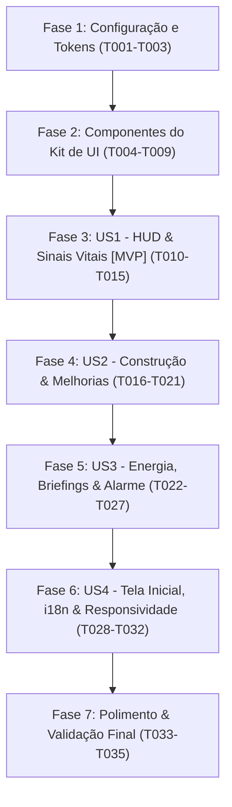

# Tarefas: UI 2D do Jogo e Kit de UI

**Entrada**: Documentos de design em `specs/003-game-ui/` (`plan.md`, `spec.md`, `research.md`, `data-model.md`, `contracts/`, `quickstart.md`) e Constituição do Projeto.

**Pré-requisitos**: `plan.md` e `spec.md` concluídos e aprovados.

**Metodologia de Testes**: **Test-First (TDD)** obrigatório conforme o Princípio VIII da Constituição. Toda funcionalidade inicia com um teste com falha (vermelho), seguido pela implementação mínima necessária (verde) e refatoração.

**Organização**: As tarefas estão agrupadas por histórias de usuário para viabilizar implementação, testes e entregas incrementais independentes.

## Formato: `[ID] [P?] [Story] Descrição com caminho do arquivo`

- **[P]**: Tarefa paralelizável (arquivos distintos, sem dependência de tarefas incompletas)
- **[Story]**: Rótulo da história de usuário correspondente (`[US1]`, `[US2]`, `[US3]`, `[US4]`)
- Todos os caminhos de arquivos são relativos à raiz do repositório

---

## Fase 1: Configuração e Infraestrutura Inicial

**Objetivo**: Preparar tokens de design e alinhamento de contratos do Kit de UI.

- [x] T001 [P] Validar variáveis de tokens CSS (cores de alto contraste, espaçamentos, tipografia, alvos de 44px) em `src/ui-kit/tokens.css`
- [x] T002 [P] Criar definições e catálogo de ícones SVG inline (`Icon.tsx`) em `src/ui-kit/Icon.tsx`
- [x] T003 Validar exportações e integração básica de tradução (`useT`) em `src/ui-kit/i18n.ts`

---

## Fase 2: Componentes Fundamentais do Kit de UI (Pré-Requisitos Bloqueantes)

**Objetivo**: Construir os blocos visuais reutilizáveis do Kit de UI que sustentam todas as histórias de usuário.

**⚠️ CRÍTICO**: Nenhuma tela ou história de usuário pode ser finalizada sem estes componentes base.

- [x] T004 [P] Implementar variantes de botão (`primary`, `secondary`, `danger`, `active`), acessibilidade e área mínima de 44×44px em `src/ui-kit/Button.tsx` e `src/ui-kit/Button.module.css`
- [x] T005 [P] Implementar barra de recurso (`ResourceBar.tsx`) com marcador de meta, percentual numérico e suporte a animação pulsante de perigo em `src/ui-kit/ResourceBar.tsx` e `src/ui-kit/ResourceBar.module.css`
- [x] T006 [P] Implementar contêiner de cartão informativo (`Card.tsx`) com estilos semitransparentes em `src/ui-kit/Card.tsx` e `src/ui-kit/Card.module.css`
- [x] T007 [P] Implementar janela modal acessível (`Modal.tsx`) com controle de foco e backdrop em `src/ui-kit/Modal.tsx` e `src/ui-kit/Modal.module.css`
- [x] T008 Criar testes unitários para os componentes do Kit de UI em `src/ui-kit/ui-kit.test.tsx`
- [x] T009 Exportar componentes consolidados do Kit de UI em `src/ui-kit/index.ts`

**Ponto de Controle**: O Kit de UI fundamental está completo e testado. A implementação das histórias de usuário pode começar.

---

## Fase 3: História de Usuário 1 - HUD de Status da Missão e Sinais Vitais (Prioridade: P1) 🎯 MVP

**Objetivo**: Apresentar no topo da tela as 3 barras vitais (Oxigênio, Água, Alimento) com metas de vitória e alerta piscante de reserva baixa, medidor de energia com destaque para déficit, carteira compacta com os 5 materiais, monitoramento dos 4 astronautas com alerta de radiação a 75% e controles de velocidade (Pausa, 1×, 2×, 4×).

**Critério de Teste Independente**: Renderizar `<Hud />` com estados simulados em `useGameStore.setState` contendo reservas baixas (< 4 U), déficit elétrico e astronauta com 75% de radiação. Verificar barras com marcas de meta, alertas visuais ativos, carteira de materiais e troca de velocidade.

### Testes da História de Usuário 1 (TDD - Test-First) ⚠️

> **NOTA: Implemente os testes primeiro e garanta que falhem antes de codificar a solução.**

- [x] T010 [US1] Ativar e expandir os testes de sinais vitais, metas de vitória e alerta de reserva baixa em `src/features/hud/Hud.test.tsx`
- [x] T011 [US1] Implementar testes para exibição do balanço de energia (superávit e déficit negativo com alerta) em `src/features/hud/Hud.test.tsx`
- [x] T012 [P] [US1] Implementar testes para a carteira de materiais (Hematita, Regolito, Ferro, Aço, Peças de Reparo) em `src/features/hud/Hud.test.tsx`
- [x] T013 [P] [US1] Implementar testes para o painel da tripulação (status dos 4 astronautas e aviso pulsante em 75% de radiação) em `src/features/hud/Hud.test.tsx`

### Implementação da História de Usuário 1

- [x] T014 [US1] Integrar o componente `ResourceBar` para Oxigênio, Água e Alimento no HUD, exibindo metas de vitória (`/ 16`, `/ 32`, `/ 16`) e ativando classe de pulso quando o estoque for menor que o consumo de uma estação (4, 8, 4) em `src/features/hud/Hud.tsx` e `src/features/hud/Hud.module.css`
- [x] T015 [US1] Implementar seções do medidor de energia, carteira de recursos e painel de status/exposição da tripulação com estilos responsivos em `src/features/hud/Hud.tsx` e `src/features/hud/Hud.module.css`

**Ponto de Controle**: A História de Usuário 1 (MVP) está 100% funcional e com todos os testes de `Hud.test.tsx` passando.

---

## Fase 4: História de Usuário 2 - Interface de Construção da Base e Melhorias (Prioridade: P2)

**Objetivo**: Oferecer menu lateral de construção agrupando estruturas por nível tecnológico (1, 2, 3), desabilitando construções inacessíveis com indicação explícita do que falta, exibindo ficha informativa da ciência da NASA antes da compra, e disponibilizando menu de melhorias específicas para a estrutura selecionada no grid.

**Critério de Teste Independente**: Renderizar `<BuildMenu />` e `<UpgradePanel />` com carteira simulada. Verificar agrupamento por níveis, botão desabilitado indicando recurso faltante, ativação de modo de posicionamento ao clicar em estrutura acessível e listagem de melhorias compatíveis ao selecionar um habitat ou usina.

### Testes da História de Usuário 2 (TDD - Test-First) ⚠️

- [x] T016 [US2] Ativar e expandir os testes de agrupamento por níveis (1, 2, 3) e bloqueio por recursos insuficientes com texto explicativo em `src/features/decisions/BuildMenu.test.tsx`
- [x] T017 [US2] Implementar testes para exibição da ficha educativa (ciência de Marte) e ativação/cancelamento do modo de posicionamento em `src/features/decisions/BuildMenu.test.tsx`
- [x] T018 [P] [US2] Criar testes unitários para o painel de melhorias da estrutura selecionada em `src/features/decisions/UpgradePanel.test.tsx`

### Implementação da História de Usuário 2

- [x] T019 [US2] Reformular `BuildMenu.tsx` para agrupar construções por nível tecnológico, desabilitar opções caras demais indicando os recursos faltantes e exibir fichas científicas em `src/features/decisions/BuildMenu.tsx` e `src/features/decisions/Panel.module.css`
- [x] T020 [US2] Criar `UpgradePanel.tsx` e seus estilos para listar apenas as melhorias compatíveis com a estrutura selecionada, exibindo custos, efeitos e acionando `installUpgrade` em `src/features/decisions/UpgradePanel.tsx` e `src/features/decisions/Panel.module.css`
- [x] T021 [US2] Integrar `UpgradePanel` ao `BuildMenu`, já montado por `src/app/App.tsx`, sem editar o shell pertencente à área `engine/`

**Ponto de Controle**: As Histórias de Usuário 1 e 2 estão completas, com testes passando em isolamento.

---

## Fase 5: História de Usuário 3 - Gestão da Rede Elétrica, Briefings da Comandante e Alarmes de Radiação (Prioridade: P3)

**Objetivo**: Permitir controle operacional por chaves elétricas (Off / Min / Max) para cada tipo de instalação, exibir transmissões narrativas sazonais da Comandante Vega com congelamento do tempo de simulação (incluindo o alerta preventivo antes do Ciclo 3 sobre o inverno) e apresentar banner/modal de emergência para tempestades de radiação com contagem de 10s e ação de abrigar tripulação em 1 clique.

**Critério de Teste Independente**: Renderizar `<PowerPanel />`, `<BriefingDialog />` e `<RadiationAlarmModal />` sob estados de simulação específicos. Verificar alteração dos modos elétricos na store, pausa e exibição correta dos textos sazonais e acionamento de `shelterAll()` pelo botão de emergência.

### Testes da História de Usuário 3 (TDD - Test-First) ⚠️

- [x] T022 [US3] Criar testes para o painel de chaves de energia (Off / Min / Max por tipo de estrutura) em `src/features/decisions/PowerPanel.test.tsx`
- [x] T023 [US3] Criar testes para a caixa de diálogo de briefing da Comandante Vega (pausa da missão, textos por ciclo/estação e dica pré-ciclo 3) em `src/features/decisions/BriefingDialog.test.tsx`
- [x] T024 [P] [US3] Criar testes para o modal de alarme de radiação (contagem regressiva de 10s, link do evento DONKI e ação `shelterAll`) em `src/features/decisions/RadiationAlarmModal.test.tsx`

### Implementação da História de Usuário 3

- [x] T025 [US3] Aprimorar `PowerPanel.tsx` para apresentar as chaves de modo com botões ativos e reflexo imediato no balanço em `src/features/decisions/PowerPanel.tsx`
- [x] T026 [US3] Aprimorar `BriefingDialog.tsx` para incluir retrato da Comandante Vega, formatação narrativa dos ciclos/estações e aviso obrigatório sobre o frio do Ano 3 em `src/features/decisions/BriefingDialog.tsx` e `src/features/decisions/Panel.module.css`
- [x] T027 [US3] Implementar o componente `RadiationAlarmModal.tsx` conectado ao estado `radiationStorm`, com contagem de 10 segundos, referência DONKI e botão "Abrigar Tripulação" chamando `shelterAll()` em `src/features/decisions/RadiationAlarmModal.tsx` e `src/features/decisions/Panel.module.css`

**Ponto de Controle**: As Histórias 1, 2 e 3 estão integradas e funcionais com todos os testes passando.

---

## Fase 6: História de Usuário 4 - Tela Inicial, Suporte Bilíngue, Layout Responsivo e Acessibilidade (Prioridade: P4)

**Objetivo**: Proporcionar tela inicial polida com entrada na missão, fontes científicas e alternância de idioma (EN/PT) imediata em toda a aplicação, layout responsivo adaptável a telas de celulares e tablets com alvos de toque >= 44px e validação completa de contraste e acessibilidade (WCAG AA).

**Critério de Teste Independente**: Renderizar `<TitleScreen />` e alternar o idioma entre Português e Inglês, verificando tradução reativa em tempo de execução sem recarregar página; verificar responsividade e alvos de toque >= 44px em navegadores reduzidos.

### Testes da História de Usuário 4 (TDD - Test-First) ⚠️

- [ ] T028 [US4] Criar testes unitários para a tela inicial (navegação para missão, fontes científicas e alternância de idioma) em `src/features/title/TitleScreen.test.tsx`
- [ ] T029 [P] [US4] Criar testes de acessibilidade e internacionalização transversal (`useT`) em `src/ui-kit/a11y.test.tsx`

### Implementação da História de Usuário 4

- [ ] T030 [US4] Refinar `TitleScreen.tsx` com arte visual tática, botões grandes e alternância fluida entre EN e PT em `src/features/title/TitleScreen.tsx`
- [ ] T031 [US4] Adicionar regras de mídia responsiva (breakpoints para tablets e smartphones com gavetas de menu inferiores e cabeçalho flexível) em `src/features/hud/Hud.module.css` e `src/features/decisions/Panel.module.css`
- [ ] T032 [US4] Revisar atributos ARIA (`aria-label`, `aria-live` para alertas vitais e foco de teclado) em todos os componentes em `src/features/hud/Hud.tsx` e `src/features/decisions/`

**Ponto de Controle**: Todas as 4 histórias de usuário estão completas, acessíveis, bilíngues e responsivas.

---

## Fase 7: Polimento e Validação Transversal

**Objetivo**: Garantir que o código esteja perfeitamente limpo, formatado, sem violações de posse e com 100% dos testes da área Dev B passando.

- [ ] T033 Executar validação de linter e formatação (`npm run check`) e corrigir eventuais avisos
- [ ] T034 Executar toda a suíte de testes da área UI (`npx vitest run src/features/hud src/features/decisions src/features/title src/ui-kit`) e assegurar 100% de sucesso
- [ ] T035 Executar o roteiro de testes do guia de validação rápida (`quickstart.md`) no navegador com `npm run dev`

---

## Dependências e Ordem de Execução

### Oportunidades de Execução Paralela

- **Fase 1 & 2**: `tokens.css` (T001), `Icon.tsx` (T002), `Button.tsx` (T004), `ResourceBar.tsx` (T005), `Card.tsx` (T006) e `Modal.tsx` (T007) atuam em arquivos independentes e podem ser desenvolvidos em paralelo.
- **Dentro de cada História de Usuário**:
  - Testes unitários marcados com `[P]` (ex.: T012, T013 na US1; T018 na US2; T024 na US3; T029 na US4) podem ser criados em paralelo com os testes principais.
  - Componentes e módulos CSS desacoplados podem ser criados simultaneamente.

---

## Estratégia de Implementação e Entrega

1. **MVP Imediato (US1)**: Concluir as Fases 1, 2 e 3 para ter o HUD completo e funcional com sinais vitais, energia e tripulação.
2. **Entrega Incremental (Uma PR por História)**:
   - PR 1: Kit de UI + HUD (`Hud.test.tsx`)
   - PR 2: Menu de Construção e Melhorias (`BuildMenu.test.tsx`, `UpgradePanel.test.tsx`)
   - PR 3: Chaves de Energia, Briefings da Comandante e Alarme de Radiação (`PowerPanel.test.tsx`, `BriefingDialog.test.tsx`, `RadiationAlarmModal.test.tsx`)
   - PR 4: Tela Inicial, Suporte Bilíngue, Mobile e Acessibilidade (`TitleScreen.test.tsx`, `a11y.test.tsx`)
